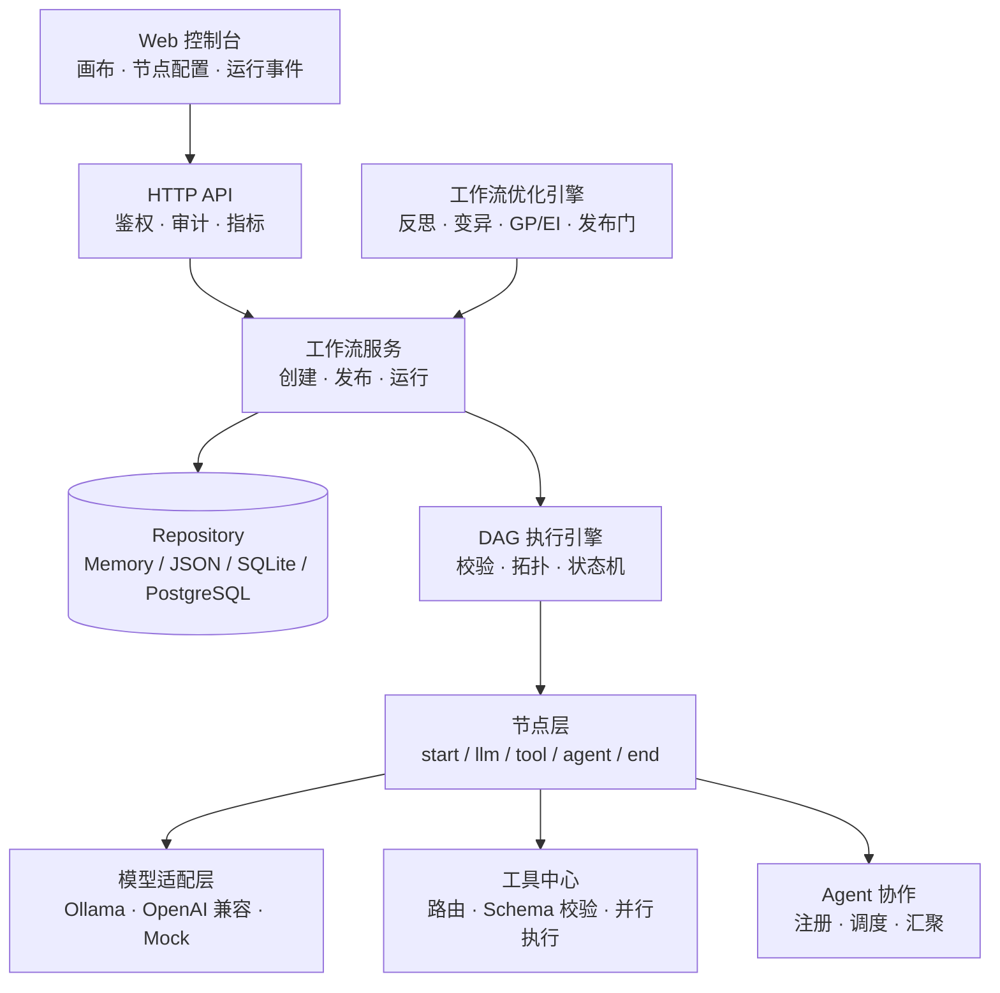
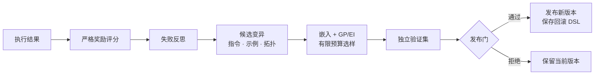

# AgentFlow

**企业级 AI 工作流编排与自进化平台**

[](https://github.com/trickytricklol/agentflow-platform/actions/workflows/tests.yml)


AgentFlow 把 LLM、工具与多 Agent 协作组织成可校验、可观测、可发布的 DAG 工作流。平台提供可视化画布、HTTP API、四种持久化后端与容器化部署，并内置基于真实执行反馈的工作流优化引擎：从失败轨迹生成候选，在有限预算内用 GP/EI 选样，经独立验证后发布，同时保留可回滚版本。

## 功能总览

| 模块 | 能力 |
|---|---|
| 可视化编排 | 拖拽节点、连线、节点配置、DSL 校验与导出；保存、发布并查看运行事件 |
| 工作流 DSL | `start` / `llm` / `tool` / `agent` / `end` 五类节点，`success` / `fail` / `always` 条件边 |
| DSL 校验 | 重复节点、悬空边、多入口、不可达节点、循环依赖检测，错误定位到节点与边 |
| 执行引擎 | Kahn 拓扑排序、分层并行、状态机、重试、超时、取消事件、逐节点事件流 |
| 模型接入 | 原生 Ollama、OpenAI 兼容接口、Mock Provider；统一 Token 用量统计 |
| 工具中心 | 两阶段路由（词法召回 + 模型语义精排）、工具 Schema 参数校验、并行执行 |
| Agent 协作 | Agent 注册、任务分发、线程池并行调度、结果汇聚与 fail-fast |
| 工作流优化 | 严格奖励、失败反思变异、示例回放、神经嵌入、RBF-GP/EI、受限拓扑搜索、Pareto 合并、指令 × 示例联合搜索、安全约束、冻结确认与回滚 |
| 版本管理 | 工作流创建、校验、发布、运行、SSE 事件流与回滚 DSL |
| 治理 | Bearer Token 鉴权、RBAC、审计日志、运行指标 |
| 持久化 | Memory / JSON / SQLite / PostgreSQL 四套 Repository |
| 交付 | 核心运行时仅依赖 Python 标准库，附 Dockerfile、docker-compose 与 GitHub Actions |

## 系统架构



## 快速开始

环境要求：Python 3.11+。核心服务不需要安装第三方包；运行测试需要 `pytest`。

```powershell
git clone https://github.com/trickytricklol/agentflow-platform.git
cd agentflow-platform

# PowerShell
$env:PYTHONPATH="$PWD\backend\src"
python -m agentflow.api
```

```bash
# macOS / Linux
PYTHONPATH=backend/src python -m agentflow.api
```

服务默认监听 `http://127.0.0.1:8080`：

```bash
curl http://127.0.0.1:8080/health
# {"status": "ok", "metrics": {}}
```

打开 `frontend/index.html` 即可使用可视化控制台。画布默认连接 `http://127.0.0.1:8080`，如需修改，编辑 `frontend/app.js` 顶部的 `API` 常量。

## 定义并运行一个工作流

```json
{
  "version": "1.0",
  "nodes": [
    {"id": "start", "type": "start", "config": {}},
    {"id": "answer", "type": "llm", "config": {"prompt": "用一句话回答：{{question}}", "model": "mock"}},
    {"id": "end", "type": "end", "config": {}}
  ],
  "edges": [
    {"source": "start", "target": "answer", "when": "success"},
    {"source": "answer", "target": "end", "when": "success"}
  ]
}
```

```python
from agentflow.core import WorkflowEngine, WorkflowGraph
from agentflow.nodes import LLMNode
from agentflow.providers import MockProvider

dsl = {  # 上面的 DSL
    "version": "1.0",
    "nodes": [
        {"id": "start", "type": "start", "config": {}},
        {"id": "answer", "type": "llm", "config": {"prompt": "用一句话回答：{{question}}", "model": "mock"}},
        {"id": "end", "type": "end", "config": {}},
    ],
    "edges": [
        {"source": "start", "target": "answer", "when": "success"},
        {"source": "answer", "target": "end", "when": "success"},
    ],
}

graph = WorkflowGraph.from_dsl(dsl)
result = WorkflowEngine(graph, {
    "start": lambda node, values: None,
    "llm": LLMNode(MockProvider("AgentFlow 已就绪。")),
    "end": lambda node, values: values.get("answer"),
}).run({"question": "你是谁"})

print(result.status.value, result.nodes["end"].value)
```

接入本地模型只需替换 Provider：

```python
from agentflow.providers import OllamaProvider

provider = OllamaProvider("http://127.0.0.1:11434")
# 节点 config 中的 model 使用 qwen3:1.7b 等已拉取的模型名
```

## 执行语义

- 执行前先做 DSL 校验，再构建 DAG，最后调度节点。
- 节点状态：`INIT → MARK → RUNNING → SUCCESS | ERROR | SKIP`。
- 一个节点在全部必需前置节点结束后激活；`success` / `fail` 边决定分支走向，`always` 边无条件激活。
- 独立节点按 DAG 层并行执行（`ThreadPoolExecutor`），同层结果汇聚后进入下一层。
- 失败按 `max_retries` 重试；超过次数后节点进入 `ERROR`，并按 `fail` 边转移到兜底分支。
- 每次状态迁移产生事件；`run_parallel` 支持 `timeout_seconds` 与 `cancel_event`。

## 模型接入

| Provider | 适用场景 | 构造方式 |
|---|---|---|
| `OllamaProvider` | 本地 Ollama 原生接口，支持 `seed`、`num_predict`、思考控制 | `OllamaProvider("http://127.0.0.1:11434")` |
| `OpenAICompatibleProvider` | OpenAI、DeepSeek、通义千问及任意兼容 `/chat/completions` 的服务 | `OpenAICompatibleProvider(base_url, api_key)` |
| `MockProvider` | 单元测试与离线联调 | `MockProvider("response")` |

Ollama 常用模型：

```bash
ollama pull qwen3:1.7b        # 任务执行
ollama pull qwen3:4b          # 候选变异
ollama pull nomic-embed-text  # 文本嵌入
```

通过 `POST /models` 注册的模型以注册名作为节点 `config.model` 的取值；未注册时回退到 `AGENTFLOW_OLLAMA_URL` / `AGENTFLOW_OPENAI_BASE_URL` 指定的默认 Provider。

## 工具路由与 Agent 协作

```python
from agentflow.tools import ToolDefinition, ToolRouter

router = ToolRouter()
router.register(ToolDefinition(
    "create_ticket",
    "创建售后工单，需要订单号与问题描述",
    lambda order_id, reason: {"order_id": order_id, "reason": reason},
    {"order_id": {"type": "string"}, "reason": {"type": "string"}},
))
tools = router.route("帮我为订单 A100 创建售后工单")
```

路由分两阶段：先按工具清单做词法召回，再用模型对候选做语义精排；执行前按工具 Schema 校验必填参数、基础类型与未知字段，多个工具可并行调用。

```python
from agentflow.agents import AgentDefinition, AgentOrchestrator, AgentTask

orchestrator = AgentOrchestrator(max_workers=4)
orchestrator.register(AgentDefinition("researcher", "检索资料", lambda task: task.input["query"]))
results = orchestrator.execute([
    ("researcher", AgentTask("t1", "检索竞品定价", {"query": "pricing"})),
])
```

## 工作流优化

优化对象是工作流本身，模型权重保持不变：节点指令、训练示例与受限拓扑（单节点、路由/优先级双专家、初判后复核）构成候选空间。



发布门使用三层约束：

1. 候选在验证集上的整体指标必须严格优于当前版本。
2. `route`、`priority` 等业务切片均不得退化。
3. 关键变更需通过多次重复验证与冻结确认；任一环节失败即自动回滚。

运行优化流水线（需先启动 Ollama）：

```bash
python examples/evolve_workflow.py --embedding nomic --failure-replay --output runs/my-run
python evaluation/analyze_evolution.py runs/my-run
python evaluation/compare_static.py runs/my-run

python examples/evolve_structure.py --teacher-model qwen3:4b --seed 17 --output runs/my-structure
python evaluation/analyze_structure.py runs/my-structure
python evaluation/confirm_frozen.py runs/my-structure
```

运行产物包含候选谱系、逐条输出、Token 与延迟、验证决策和回滚 DSL，默认写入 `runs/` 或 `evaluation/results/`，不进入版本库。

## HTTP API

| 方法 | 路径 | 说明 |
|---|---|---|
| `GET` | `/health` | 健康检查与运行指标 |
| `GET` | `/models` | 已注册模型列表 |
| `POST` | `/models` | 注册模型 |
| `GET` | `/workflows` | 工作流列表 |
| `POST` | `/workflows` | 创建工作流（保存前执行 DSL 校验） |
| `GET` | `/workflows/{id}` | 工作流详情 |
| `POST` | `/workflows/{id}/publish` | 发布工作流 |
| `POST` | `/workflows/{id}/run` | 同步运行，返回节点状态与事件 |
| `POST` | `/workflows/{id}/run/stream` | SSE 运行事件流 |

鉴权默认关闭。开启后所有请求需携带 Bearer Token：

```bash
AGENTFLOW_AUTH_ENABLED=1 AGENTFLOW_API_TOKEN=your-token python -m agentflow.api
curl -H "Authorization: Bearer your-token" http://127.0.0.1:8080/workflows
```

完整请求与响应示例见 [docs/api.md](docs/api.md)。

## 容器化部署

```bash
cd deploy
docker compose up --build
```

服务暴露在 `8080` 端口，工作流数据写入命名卷 `agentflow-data`。生产环境请开启鉴权、替换默认 Token，并按需挂载模型服务或外部数据库。

## 测试

```powershell
$env:PYTHONPATH="$PWD\backend\src"
$env:PYTEST_DISABLE_PLUGIN_AUTOLOAD="1"
python -m pytest backend/tests -q
```

测试覆盖 DSL 校验、拓扑与并行调度、分支与重试、五类节点、Provider、工具路由、Agent 调度、版本发布、四类持久化、鉴权审计与优化算法。GitHub Actions 在 Python 3.11 上执行同一套测试。

## 目录结构

```text
agentflow-platform/
├── backend/
│   ├── src/agentflow/
│   │   ├── api.py              # HTTP API 与 SSE
│   │   ├── core/               # DSL、DAG、执行引擎
│   │   ├── nodes/              # 五类内置节点
│   │   ├── providers/          # Ollama / OpenAI 兼容 / Mock
│   │   ├── tools/              # 工具注册、路由、校验、并行执行
│   │   ├── agents/             # Agent 注册与调度
│   │   ├── service/            # 工作流服务与四类 Repository
│   │   ├── security/           # 鉴权、审计、指标
│   │   └── optimization/       # 奖励、变异、嵌入、GP/EI、结构搜索、发布门
│   └── tests/                  # pytest 测试集
├── frontend/                   # 零依赖可视化画布
├── deploy/                     # Dockerfile 与 docker-compose
├── examples/                   # 可执行示例
├── evaluation/                 # 数据集与评估工具
├── docs/                       # 架构、API、部署、优化文档
└── specs/                      # 领域模型与接口规格
```

## 文档

- [架构设计](docs/architecture.md)
- [HTTP API](docs/api.md)
- [模型配置](docs/models.md)
- [工作流优化](docs/optimization.md)
- [部署与运维](docs/deployment.md)
